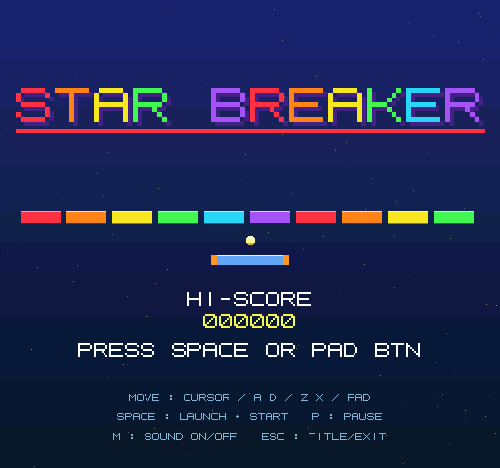

[English](README.en.md) | [日本語](README.md)

# STAR BREAKER for X68000



**[Launch STAR BREAKER in WebX68k](https://uraraworks.github.io/WebX68k/?cpu=10&fd1=https://raw.githubusercontent.com/renatus-novus-x/starbreaker/main/dist/starbreaker.xdf&run=1)**

※ このリポジトリが Private の間は、上のリンクからは起動できません
（ディスクイメージの読み込みに認証が必要なため）。Public に切り替えた
時点で有効になります。

elf2x68k (m68k-xelf-gcc/g++ 13.5.0) で作った X68000 用ブロック崩し
『STAR BREAKER』です。
**Human68k なしで動きます。** 本体はブート可能なシステムファイル
`breakout.sys` で、ディスクに `HUMAN.SYS` として置くと X68000 の
IPL が直接起動します（elf2x68k-sample の `hellosys` と同じ方式）。

## 成果物

| ファイル | 内容 |
|---|---|
| `dist/starbreaker.xdf` | ブート用ディスクイメージ（同梱）。中身は HUMAN.SYS のみ |
| `breakout.sys` | 本体（ブート用システムバイナリ、約29KB、`make` で生成） |
| `breakout.x` | Human68k 用 .X 版（同じソースから `make` で生成） |

## 遊び方

`dist/starbreaker.xdf` をエミュレータ（WebX68k など）の FDD0 に入れて
「セットしたディスクで起動」するだけです。実機では 2HD フロッピーに
書き込んで起動してください。

## 操作

| 入力 | 動作 |
|---|---|
| カーソル ← → / A D / Z X キー | パドル移動 |
| ジョイパッド ← → | パドル移動 |
| SPACE / パッドボタン | ゲーム開始、ボール発射、リトライ |
| P | ポーズ |
| M | サウンド ON/OFF |
| ESC | タイトルへ戻る（タイトルでは終了） |

※ キーボードで使うのはカーソル左右・スペース・英字キー・ESC のみです。

## ルール

- ボールは残り3個。全部落とすとゲームオーバー
- ブロックは 10列 x 6行 = 60個。上の段ほど高得点（60〜10点）
- 全部消すとボーナス500点で次のステージへ（ボールが速くなります）
- パドルの当たった位置で反射角が変わります（5ゾーン）

## 仕様

- 画面: CRTMOD 12 を CRTC 書き換えで 60Hz 化し 512x480 表示
  （renatus-novus-x/pong の手法。総ライン数 524 本、帰線中に
  R05=1 / R06=0x22 / R07=0x202 / R04=0x020C を書く）
  65536色（グラデーション背景 + 星空、ベベル付きブロック、
  8x8ドットフォント自前描画。フォントは MSXPen 共有コード
  「8x8 ORIGINAL FONT 1 fix」(https://msxpen.com/codes/-Nq8q6wabU6mJ4onDmYE)
  の ASCII 0x20〜0x7F を使用、MSX版 breakout と共通）
- フレーム同期: MFP GPIP の VDISP 信号に同期（1リフレッシュ=
  1フレーム、帰線直後から更新・描画するのでちらつきなし。
  VDISP が来ない環境では ONTIME の 60Hz ペーシングに自動降格）
- 言語: C++（クラス構成: Gfx / Fm / Game、固定小数点の物理演算）
- 音: YM2151 (OPM) を IOCS `_iocs_opmset` で直接駆動
  - BGM: リード + ベースの 2ch シーケンサ（64ステップループ、
    Aマイナーの近未来風シンセウェーブ：コードごとのアルペジオと
    オクターブパルスのベースライン、コード進行 Am–F–C–G）
  - SE: 反射・ブロック消去・発射などを別チャンネルで発音
  - ジングル: スタート / ステージクリア / ゲームオーバー / ミス
- 入力: IOCS `_iocs_b_keysns/_iocs_b_keyinp` + `_iocs_joyget`
- デモプレイ: タイトルで約5秒間無入力だと AI によるデモプレイが
  始まる（HUD 右上に DEMO 表示）。何か入力するとタイトルに戻り、
  デモ中のスコアはハイスコアに残らない
- 描画の最適化 (2026-10-23): 10MHz でも 60fps 級を維持するため
  ハードウェアを活用。実測で PLAY 49.4fps → 57.9fps (10MHz)、
  フレーム処理 15.1ms → 0.7ms
  - ボールとパドルはハードウェアスプライト (ボール1枚 + パドル
    16px x 5枚 = 幅80px)。位置はスプライト RAM (0xEB0000) へ
    直接書く (IOCS `_iocs_sp_regst` は帰線待ちで直列化するため
    不可)。パターンの 8x8 象限の並びは TL,BL,TR,BR の順
    (テストカードで実測)。512x480 化した CRTC ではスプライトが
    グラフィックより 6 ライン下に出るので Y を -6 補正
  - HUD はテキスト画面へ移行し、値が変わった項目だけ
    B_LOCATE + B_PRINT で部分更新
  - ブロック消去・背景復元・全画面背景は GVRAM 直接書込
    (0xC00000、行ピッチ 1024 バイト、32bit 書込で 2px 同時)。
    .X 版は起動時に `_iocs_b_super(0)` でスーパーバイザ化
  - BG プレーンは WebX68k 上で挙動が安定しないため不採用
    (星空はグラフィック画面への静的描画で毎フレームのコスト 0)
- 旧仕様メモ: 当初は 512x512 / ONTIME 50fps で、モード12本来の
  約55Hz表示と周期が合わずちらつきの余地があった

## ビルド

```sh
export PATH=$HOME/workspace/x68k/m68k-xelf/bin:$PATH
make            # breakout.sys と breakout.x
```

- `breakout.sys` は `-Ttext=0x6800 -specs=x68knodos.specs -DSTANDALONE` でリンク
- ブート用ディスクイメージはビルド済みを `dist/starbreaker.xdf` に
  同梱してあります（イメージの生成には Human68k 3.02 のディスク
  イメージをテンプレートとして使う専用スクリプトが必要で、本
  リポジトリには含まれません）

## 動作確認 (2026-10-23, WebX68k)

- 本体を WebX68k でタイトル→ゲーム開始→プレイ→ポーズ→タイトル
  復帰まで確認
- 60Hz 化の検証: モード12デフォルトの実リフレッシュを実測 =
  55.33Hz。CRTC 総ライン数を 524 本に書き換えると 59.66Hz に
  なることを確認
- 最適化版の検証: 16MHz / 10MHz とも計測。10MHz で
  PLAY 57.92fps・処理 0.7ms/frame (従来は 49.40fps・15.1ms)。
  製品版も 10MHz でプレイ確認済み (タイトル→サーブ→発射→
  破壊→ミス→ポーズ→再開、スプライトの見た目とテキスト HUD の
  配置を含む)。.X 版も Human68k から起動して同等に動作
